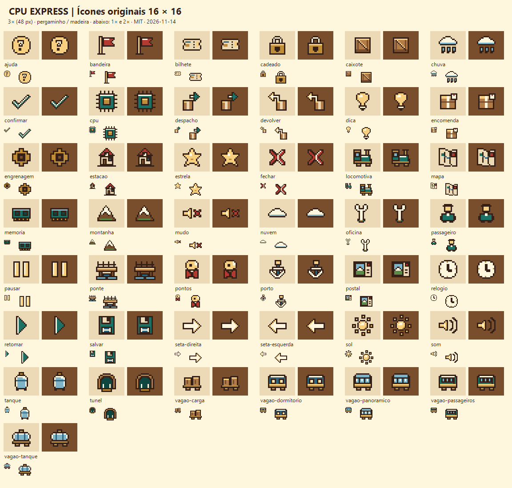

# Ícones originais do CPU Express

43 símbolos iniciais, desenhados por Codex para o projeto em **14/11/2026**, mais oito símbolos econômicos da E6 em **16/11/2026** (51 no total). Geometria autoral construída com coordenadas de retângulos e células desenhadas manualmente; sem vetorização automática de imagens, extração de sprites ou cópia de recursos do jogo de referência. Não foi usada geração de imagem nesta entrega.

Mesma **licença MIT** do projeto: [LICENSE](../../LICENSE), copyright © 2026 CPU Express contributors. Os SVGs, esta documentação, o validador e a folha de conferência são distribuídos sob essa licença. Não há dependências ou recursos gráficos de terceiros nos ícones.

## Contrato dos sprites

- Um arquivo por símbolo, nomes ASCII em minúsculas e hífens.
- Raiz: `<svg xmlns='http://www.w3.org/2000/svg' viewBox='0 0 16 16' shape-rendering='crispEdges'>`.
- Apenas filhos `<rect x='…' y='…' width='…' height='…' fill='#…'/>`.
- Coordenadas e dimensões inteiras; dimensões positivas; `x + width <= 16`, `y + height <= 16`.
- Sem fundo, texto, path, stroke, grupo, transformação, CSS, gradiente, filtro, referência externa ou imagem embutida. O que não é pintado fica transparente.
- Contorno em `#342016`, com borda externa de um pixel e junções em degraus. Hastes e detalhes internos podem usar o mesmo tom; encontros de contornos não são um stroke vetorial.
- Máximo de seis cores por ícone, todas da paleta abaixo. Retângulos finais não se sobrepõem; cada faixa horizontal conserva a grade.
- Desenhados para 16 × 16; usar 32 × 32 ou 48 × 48 em escala inteira, sem suavização. Alinhar a origem aos pixels físicos. Em egui, considerar `pixels_per_point` para manter essa regra.

Os arquivos finais são autossuficientes. O conversor não precisa de fonte, biblioteca SVG completa nem script de autoria: basta preencher os retângulos RGBA. Gerar/carregar sprites uma vez e reutilizar texturas com filtro nearest. Não rasterizar por frame.

## Paleta autorizada

| Cor | Uso |
| --- | --- |
| `#342016` | Contorno e detalhes escuros |
| `#794E2D` | Madeira |
| `#B27C48` | Madeira clara |
| `#FFF6DE` | Creme, luz e detalhes |
| `#EBDAB5` | Pergaminho |
| `#F6D080` | Manteiga |
| `#BF8D37` | Ouro |
| `#1C7064` | Verde |
| `#104640` | Verde escuro |
| `#2F647E` | Azul |
| `#B23A30` | Vermelho |
| `#7FB4C8` | Azul claro |
| `#5B8C4A` | Folha |

## Inventário e intenção

Adições E6: `moeda.svg` (roda ferroviária), `pilha-moedas.svg`, `saco-moedas.svg` e cinco remessas distintas: `caixa-patio.svg` (madeira), `caixa-oficina.svg` (engradado metálico), `caixa-plataforma.svg` (mala), `caixa-garagem.svg` (galpão) e `caixa-atelie.svg` (lata). `grandes/moeda-48.svg` é a versão ampliada por três, preservando os pixels. O subdiretório de versões grandes não entra na tabela 16 × 16. Geometria reproduzível com `node assets/icons/draw_economy.cjs`; integração e limitação do Python local em [MENUS_E6.md](../../docs/expansao/MENUS_E6.md).

| Arquivo | Leitura e uso sugerido |
| --- | --- |
| [locomotiva.svg](locomotiva.svg) | Vapor de perfil, cabine e chaminé; Trem/Motores |
| [mapa.svg](mapa.svg) | Mapa dobrado com itinerário; Viagem/Mapa |
| [oficina.svg](oficina.svg) | Chave de oficina; equipamento |
| [engrenagem.svg](engrenagem.svg) | Roda dentada; ajustes |
| [ajuda.svg](ajuda.svg) | Medalhão com interrogação desenhada em pixels; ajuda geral |
| [fechar.svg](fechar.svg) | Cruz vermelha; fechar o painel, não encerrar o jogo |
| [passageiro.svg](passageiro.svg) | Viajante com boné e casaco; pessoas/lugares |
| [caixote.svg](caixote.svg) | Caixa de madeira com travessa; suprimentos/carga seca |
| [tanque.svg](tanque.svg) | Reservatório vertical; líquidos/capacidade compatível |
| [encomenda.svg](encomenda.svg) | Pacote amarrado com etiqueta; contrato de encomenda |
| [bilhete.svg](bilhete.svg) | Bilhete picotado; chegada/registro |
| [estacao.svg](estacao.svg) | Plataforma coberta com relógio; estação |
| [relogio.svg](relogio.svg) | Relógio de ponteiros; tempo ativo/espera |
| [estrela.svg](estrela.svg) | Estrela de cinco pontas; conquista/favorito |
| [cadeado.svg](cadeado.svg) | Cadeado dourado; bloqueio com requisito |
| [confirmar.svg](confirmar.svg) | Marca verde; confirmação/equipado/concluído |
| [pausar.svg](pausar.svg) | Duas barras; pausar |
| [retomar.svg](retomar.svg) | Triângulo verde; retomar |
| [salvar.svg](salvar.svg) | Disquete; salvar/arquivo da viagem |
| [sol.svg](sol.svg) | Disco luminoso e raios; céu claro |
| [nuvem.svg](nuvem.svg) | Nuvem clara com base azul; nublado |
| [chuva.svg](chuva.svg) | Nuvem e três gotas; chuva |
| [cpu.svg](cpu.svg) | Processador com pinos nos quatro lados; CPU |
| [memoria.svg](memoria.svg) | Módulo com chips e contatos; RAM |
| [pontos.svg](pontos.svg) | Condecoração com fitas; pontos de serviço, sem aparência de moeda |
| [postal.svg](postal.svg) | Cartão com paisagem, selo e linhas; coleção |
| [porto.svg](porto.svg) | Âncora; porto/litoral |
| [montanha.svg](montanha.svg) | Pico e encosta; serra |
| [tunel.svg](tunel.svg) | Portal arqueado e trilhos; túnel |
| [ponte.svg](ponte.svg) | Tabuleiro, pilares e água; ponte |
| [bandeira.svg](bandeira.svg) | Bandeira vermelha; objetivo em andamento/destino |
| [som.svg](som.svg) | Alto-falante e ondas; som ligado |
| [mudo.svg](mudo.svg) | Alto-falante com cruz; som desligado |
| [dica.svg](dica.svg) | Lâmpada; explicação contextual |
| [seta-esquerda.svg](seta-esquerda.svg) | Seta curta; anterior/voltar |
| [seta-direita.svg](seta-direita.svg) | Seta espelhada; próximo/avançar |
| [despacho.svg](despacho.svg) | Pacote e seta de saída; despacho |
| [devolver.svg](devolver.svg) | Pacote e seta de retorno; devolver à origem |
| [vagao-passageiros.svg](vagao-passageiros.svg) | Vagão verde com janelas pequenas regulares |
| [vagao-dormitorio.svg](vagao-dormitorio.svg) | Vagão azul com dois compartimentos iluminados |
| [vagao-panoramico.svg](vagao-panoramico.svg) | Teto elevado e grandes painéis de vidro |
| [vagao-carga.svg](vagao-carga.svg) | Plataforma com caixotes de alturas diferentes |
| [vagao-tanque.svg](vagao-tanque.svg) | Reservatório horizontal sobre rodas |

Os cinco vagões compartilham altura de engate/chassi e posição das rodas. O ícone vertical `tanque` identifica a categoria de líquido; `vagao-tanque` identifica a peça equipável. O símbolo `pontos` deve vir acompanhado de “pontos”, especialmente na primeira exposição. Despacho e devolução também precisam de rótulo: suas setas explicam direção, não todas as consequências da ação.

## Conferência

[Abrir folha de conferência](preview.png)



Cada par superior usa 48 × 48 px, primeiro sobre pergaminho `#EBDAB5`, depois sobre madeira `#794E2D`. Abaixo do nome estão as amostras de 16 e 32 px. A folha é PNG para não confundir o importador que procura SVGs de sprites. Seus fundos e rótulos pertencem apenas à folha, nunca aos ícones.

## Validação reproduzível

Na raiz do projeto, executar:

```powershell
powershell -NoProfile -ExecutionPolicy Bypass -File assets/icons/validar.ps1
```

`-ExecutionPolicy Bypass` aplica-se apenas ao processo que executa o script local; não altera a política persistente da máquina. O script não usa rede nem Cargo e não modifica os SVGs.

O [validador](validar.ps1) verifica inventário exato de 43 arquivos, XML sem DTD, namespace, viewBox, crispEdges, filhos exclusivamente rect, atributos permitidos, números inteiros, limites da grade, paleta, até seis cores por arquivo, transparência, contorno externo e ausência de sobreposição. Para conferir o contorno, nenhum pixel colorido pode tocar transparência nas quatro direções ortogonais. A inspeção da folha complementa a validação estrutural; ela não prova reconhecimento por todos os jogadores ou acessibilidade da integração.

**Resultado executado em 14/11/2026:** 43/43 SVGs aprovados; 2.298 retângulos, máximo de seis cores por ícone. Folha final inspecionada em 1×, 2× e 3×. Não foi executado Cargo nem teste do aplicativo.

## Integração e acessibilidade

Manter os nomes de arquivo estáveis. Não remover rótulos de Trem, Viagem, Visual, Janela ou Ajuda por haver ícones novos. Os SVGs não contêm texto nem metadados acessíveis por exigência do formato: o widget precisa fornecer nome, papel, valor, seleção, foco e motivo de bloqueio. Cor acompanha forma e texto; não comunica estado sozinha. Preservar as formas de texto egui e a informação semântica ao lado da arte pixelada.

Usar alvo de clique maior que o sprite: 16 px de desenho não devem implicar 16 px de área interativa. Em fundos muito escuros, usar superfície clara do próprio controle e foco separado; não introduzir um retângulo opaco dentro do sprite. Para itens equipáveis, as miniaturas reais de `ui_stock` continuam sendo a visualização fiel do trem. Estes ícones identificam categorias e ações.

Nenhum SVG foi integrado ao código nesta rodada. A conversão para sprites, comportamento dos controles e validação em Windows real ficam para a implementação do redesenho.
